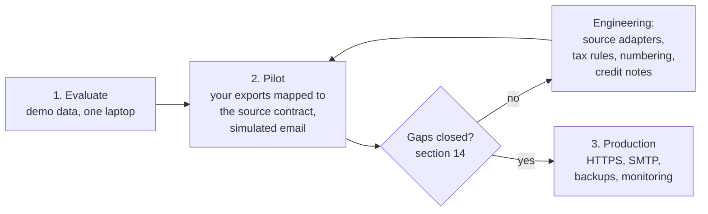
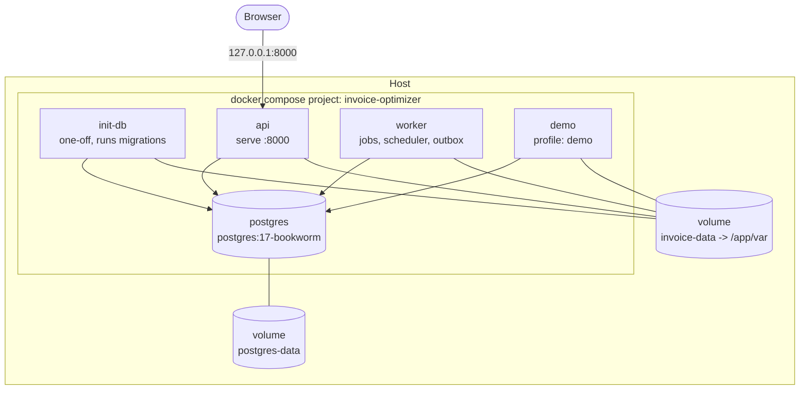
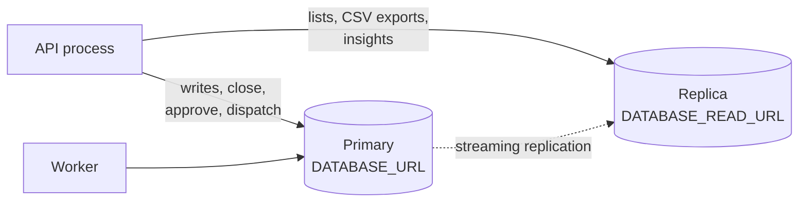
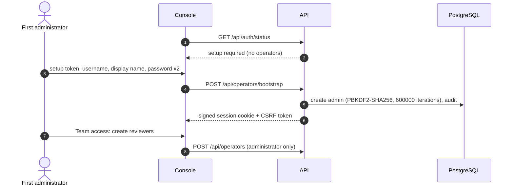

# Adopting Invoice Optimizer in your company

This guide is for the team that will install, run and own Invoice Optimizer
inside a company: platform engineers, the finance operations lead and whoever
is responsible for security. It covers installation, configuration, data
onboarding, invoice branding, email, hardening, scale, backups, monitoring and
upgrades.

Every command and variable below exists in this repository. Where something is
a recommendation rather than a tested feature, the text says so.

> **Licence.** The software is proprietary. Internal use within a company,
> including evaluation and pilots, is permitted only under a separate written
> agreement with the copyright holder. See [LICENSE](../LICENSE).

- [0. Read this first: what this release can and cannot do](#0-read-this-first-what-this-release-can-and-cannot-do)
- [1. Adoption path](#1-adoption-path)
- [2. Prerequisites](#2-prerequisites)
- [3. Deployment topologies](#3-deployment-topologies)
- [4. Configuration reference](#4-configuration-reference)
- [5. First administrator and team accounts](#5-first-administrator-and-team-accounts)
- [6. Connecting your data sources](#6-connecting-your-data-sources)
- [7. Seller identity and invoice format](#7-seller-identity-and-invoice-format)
- [8. Email delivery](#8-email-delivery)
- [9. Security hardening checklist](#9-security-hardening-checklist)
- [10. Scaling to large databases](#10-scaling-to-large-databases)
- [11. Backup and restore](#11-backup-and-restore)
- [12. Monitoring and health](#12-monitoring-and-health)
- [13. Upgrades and schema migrations](#13-upgrades-and-schema-migrations)
- [14. Engineering work before production use](#14-engineering-work-before-production-use)

## 0. Read this first: what this release can and cannot do

Invoice Optimizer is a complete, working pipeline: ingestion, reconciliation,
risk scoring, human review, monthly invoice preparation, LaTeX/PDF rendering,
human approval and email queueing. It runs today on a **documented synthetic
contract**. Several limits are enforced in code, not just in documentation:

| Limit | Where it is enforced |
|---|---|
| The service refuses to start unless `INVOICE_SYNTHETIC=1`. | `config.Settings.prepare()` |
| Source rows must be in GBP. | `ingestion.normalize()` |
| VAT is computed at a fixed 20% on the invoice net. | `billing._freeze_invoice_in_session()` |
| Invoice numbers have the form `DEMO-<year>-<8 digits>`. | `billing._freeze_invoice_in_session()` |
| Every PDF carries a `SYNTHETIC DEMO / NOT A TAX INVOICE` banner. | invoice templates |
| Issued invoices cannot be corrected (no credit notes). | `billing`, `assessment` |
| Gmail can be connected but does not send invoices. | `delivery.send_one()` uses only the simulator or SMTP |

So a company can evaluate and pilot the whole workflow now, on synthetic or
anonymised data mapped onto the contract. Issuing real tax invoices needs the
engineering work listed in [section 14](#14-engineering-work-before-production-use).

## 1. Adoption path



1. **Evaluate** (an afternoon). Follow the README quick start, run the demo,
   review cases, approve the demo invoice, inspect the simulated email in
   `var/mail/`.
2. **Pilot** (weeks). Export a month of real movements from your two systems,
   anonymise them, convert them to the source contract
   ([section 6](#6-connecting-your-data-sources)) and run the month end to end
   with the simulator. Measure review volume, close time and database growth
   with your own numbers.
3. **Production.** Only after the items in section 14 are implemented,
   reviewed and tested.

## 2. Prerequisites

| Component | Version / note |
|---|---|
| Python | 3.11 or newer (`pyproject.toml`); the Docker image uses 3.12 |
| PostgreSQL | 15 or newer; `compose.yaml` runs `postgres:17-bookworm`. SQLite is not supported. |
| LaTeX | `pdflatex` with the packages used by the templates. The Dockerfile installs `texlive-latex-base`, `-latex-recommended`, `-latex-extra`, `-fonts-recommended`, `-fonts-extra`. |
| Poppler | `pdfinfo` and `pdftoppm`, for PDF page previews in the console and `format preview` PNGs |
| Native PostgreSQL helper | `scripts/local_postgres.sh` uses `initdb`/`pg_ctl` from `INVOICE_PG_BIN` (default Homebrew `postgresql@15`) and `rg` (ripgrep) |
| Docker (optional) | Docker Engine with Compose v2 |
| Node + Playwright (optional) | Only for the browser verification scripts in `scripts/*.cjs` |

Hardware: the measured reference runs are in
[PERFORMANCE.md](PERFORMANCE.md) (for example 100,000 movements with two worker
threads and live readers, about 248 MiB peak Python RSS excluding PostgreSQL).
Size PostgreSQL storage from your own pilot; no capacity figure for two million
movements has been measured.

## 3. Deployment topologies

### A. Single host, native processes

```bash
python3 -m venv .venv
.venv/bin/python -m pip install -r requirements.lock.txt
.venv/bin/python -m pip install --no-deps -e .
.venv/bin/python scripts/bootstrap.py          # writes .env with generated secrets (mode 0600)
bash scripts/local_postgres.sh                 # project-local cluster on 127.0.0.1:55432
.venv/bin/python -m invoice_optimizer init-db
.venv/bin/python scripts/run_local.py          # API + worker on http://127.0.0.1:8765
```

`run_local.py` binds only `127.0.0.1`, starts one API and one worker, and
writes `var/api.log` and `var/worker.log`. Use `--skip-postgres-start` with an
existing PostgreSQL server and `--port` to change the port.

### B. Docker Compose

```bash
.venv/bin/python scripts/bootstrap.py          # or create .env yourself
docker compose up --build -d
docker compose --profile demo run --rm demo    # optional synthetic data
```



Facts from `compose.yaml` and the `Dockerfile`:

- The API port is published on `127.0.0.1:8000` only.
- `api` and `worker` wait for `init-db` to complete successfully.
- Containers run as a non-root user (uid 10001), with `no-new-privileges`,
  all capabilities dropped and rotated JSON logs (10 MB x 3).
- `INVOICE_SYNTHETIC` and `INVOICE_PROVIDER=simulated` are fixed in the
  compose file. Changing the provider means editing it.
- The image has a `HEALTHCHECK` on `GET /health`.
- Docker builds and container runs were not executed during development (the
  Docker daemon was unavailable); the compose file was validated only.

### C. Behind a reverse proxy (recommended for any shared use)

The application has no TLS listener of its own. Put it behind a reverse proxy
or load balancer that terminates HTTPS, and set
`INVOICE_PUBLIC_BASE_URL=https://invoices.example.test`. With an `https://`
public URL the application always sets `Secure` cookies and sends HSTS. Keep
the proxy from buffering `text/event-stream` responses (the API already sends
`X-Accel-Buffering: no`). Configuration for a specific proxy is not part of
this repository.

### D. With a read replica



Set `DATABASE_READ_URL` to a PostgreSQL URL for a replica you operate.
Replication itself is outside this project. Lists may briefly trail a write if
the replica lags; financial validation always reads the primary.

### E. More workers

Job claims use `FOR UPDATE SKIP LOCKED`, leases and claim tokens, so several
worker processes can share one database. Every worker also runs the monthly
preparation and training threads; the close and dispatch transactions take
advisory locks, so duplicates are refused rather than repeated. One measured
run used two worker threads ([PERFORMANCE.md](PERFORMANCE.md)); larger worker
counts have not been benchmarked. All workers and APIs must share the same
`INVOICE_DATA_DIR`.

## 4. Configuration reference

All application settings are read once at start-up by
`src/invoice_optimizer/config.py`. A `.env` file in the working directory is
loaded first (`python-dotenv`, existing environment wins). Restart the API and
the worker after any change.

| Variable | Default | Meaning and validation |
|---|---|---|
| `DATABASE_URL` | `postgresql+psycopg://invoice@127.0.0.1:55432/invoice_optimizer` | Primary database. Must be PostgreSQL. No default password; `scripts/bootstrap.py` writes one. |
| `DATABASE_READ_URL` | empty | Optional replica for read-only lists, exports and insights. Must start with `postgresql`. |
| `POSTGRES_PASSWORD` | none | Used by `compose.yaml` and by `scripts/local_postgres.sh` when it creates a new cluster. Not read by the application. |
| `INVOICE_API_TOKEN` | empty | Shared **read-only** console token. The API refuses to start if it is shorter than 32 characters. |
| `INVOICE_SETUP_TOKEN` | empty | One-time secret to create the first administrator. At least 32 characters and different from the API token. If empty, the API token stands in (not recommended). |
| `INVOICE_DATA_DIR` | `var` | Object store, documents, model, mail, exports, reports and the session key. |
| `INVOICE_ACTOR` | `local-reviewer` | Actor label for CLI-initiated audit events (`cli:<actor>`). |
| `INVOICE_SYNTHETIC` | `1` | Must be `1` in this release; anything else stops start-up. |
| `INVOICE_PROVIDER` | `simulated` | `simulated` or `smtp`. |
| `INVOICE_AUTO_CLOSE` | `1` | Initial default for automatic monthly preparation, until an administrator saves runtime settings. |
| `INVOICE_AUTO_DISPATCH` | `1` | Initial default for queueing already approved invoices automatically. |
| `INVOICE_BATCH_SIZE` | `1000` | Rows per ingestion chunk (1-10000). |
| `INVOICE_WORKER_BATCH_SIZE` | `500` | Movements per `ASSESS` job (1-10000). |
| `INVOICE_POLL_SECONDS` | `2` | Worker idle sleep and SSE check interval (0.1-60). |
| `INVOICE_TEX_COMPILER` | `pdflatex` | LaTeX executable. |
| `INVOICE_FORMAT_PROFILE` | `default` | Invoice profile for newly frozen drafts: 1-64 of `a-z 0-9 - _`. |
| `INVOICE_PROFILE_DIR` | `config/invoice_profiles` | Profile directory; logos are read from its `assets/` subdirectory. |
| `INVOICE_PUBLIC_BASE_URL` | `http://127.0.0.1:8765` | Public origin. Must be HTTPS, or HTTP on a loopback host. HTTPS turns on `Secure` cookies and HSTS. Also the base of the Gmail OAuth callback. |
| `INVOICE_SECURE_COOKIES` | `0` | `1` forces `Secure` cookies even on loopback HTTP. |
| `INVOICE_GMAIL_EXPECTED_EMAIL` | empty | Optional Google account that the OAuth connection must match. |
| `INVOICE_ALLOWED_EMAIL_DOMAINS` | `example.test` | Comma-separated recipient domains allowed for SMTP. |
| `SMTP_HOST` | empty | Required when `INVOICE_PROVIDER=smtp`. |
| `SMTP_PORT` | `587` | STARTTLS port. |
| `SMTP_USER` / `SMTP_PASSWORD` | empty | Optional SMTP login. |
| `INVOICE_DB_POOL_SIZE` | `4` | Connection pool per process (1-200). |
| `INVOICE_DB_MAX_OVERFLOW` | `2` | Extra connections per process (0-200). |
| `INVOICE_DB_POOL_RECYCLE_SECONDS` | `1800` | Connection recycle age (-1 to 86400). |
| `INVOICE_DB_STATEMENT_TIMEOUT_MS` | `0` | API sessions only; 0 disables (0-86400000). |
| `INVOICE_DB_LOCK_TIMEOUT_MS` | `0` | API sessions only; also bounds advisory-lock waits. |
| `INVOICE_DB_IDLE_TX_TIMEOUT_MS` | `0` | API sessions only; must exceed the slowest CSV download pause. |

Helper scripts and tests read a few more:

| Variable | Used by | Meaning |
|---|---|---|
| `INVOICE_PG_BIN` | `scripts/local_postgres.sh` | PostgreSQL binaries directory |
| `INVOICE_PG_PORT` | `scripts/local_postgres.sh` | Port for the project cluster (default 55432) |
| `INVOICE_DB_PASSWORD` | `scripts/local_postgres.sh` | Password for a new cluster if `.env` has none |
| `INVOICE_DOCKER_PUBLIC_BASE_URL` | `compose.yaml` | Public URL passed to containers (default `http://127.0.0.1:8000`) |
| `OMP_NUM_THREADS`, `OPENBLAS_NUM_THREADS`, `MKL_NUM_THREADS` | numerical libraries | Set to `1` by bootstrap and Docker to avoid oversubscription |
| `TEST_DATABASE_URL` | `tests/conftest.py` | Database for disposable test schemas |

Runtime automation settings (pause, monthly preparation, dispatch after
approval, email delivery, per-cycle limits, queue high-watermark) are stored
in the database and edited by an administrator in **Overview -> Manage
automation**, without a restart. Saved settings override `INVOICE_AUTO_CLOSE`
and `INVOICE_AUTO_DISPATCH`.

## 5. First administrator and team accounts



1. Open the console and use the first-account form with the value of
   `INVOICE_SETUP_TOKEN` from `.env`. The token is rejected once any operator
   exists.
2. Alternatively, on the server:
   `invoice-optimizer operator-create --username alice --display-name "Alice Example" --role admin`
   (the password is prompted, not passed on the command line).
3. Create a personal account for every reviewer in **Team access**. Roles are
   `admin` and `reviewer`. Passwords must be 12-256 characters.
4. Anyone signing in with the shared `INVOICE_API_TOKEN` gets **read-only**
   access. Every review, correction, approval and setting change is recorded
   against a personal account.

To rotate either token, change it in `.env` and restart the API.

## 6. Connecting your data sources

### The contract the pipeline expects

Ingestion accepts two independent deliveries per month, **source A** and
**source B**, describing the same billable movements. Each file is CSV (UTF-8),
Parquet or XLSX (an explicit sheet name is required; formulas are refused).

| Column | Required | Rule |
|---|---|---|
| `record_id` | yes | Source record key, up to 160 characters |
| `revision` | yes | Positive integer; a correction is a higher revision |
| `movement_id` | yes | Business ID of the movement, shared by A and B |
| `customer_id` | yes | Must exist in `customers` |
| `event_at` | yes | ISO 8601 with a time zone |
| `period` | yes | `YYYY-MM`; must equal the UTC month of `event_at` and the delivery period |
| `currency` | yes | `GBP` in this release |
| `amount` | yes | Non-negative decimal, at most 2 decimal places |
| `description` | yes | Up to 1000 characters |
| `supplier_id` | yes | Up to 160 characters |
| `expected_amount` | no | Model feature |
| `customer_age_days`, `supplier_age_days`, `cross_border` | no | Model features; missing values make the model score unavailable, not zero |

Deterministic rules compare A and B per movement: missing counterpart,
ambiguous keys, and mismatches of `amount`, `currency`, `supplier_id`,
`period` and `event_at`. Any mismatch blocks the movement until a person
corrects it with a reason, or a corrected delivery arrives. Rows that fail
validation are quarantined with their row number and reason; a quarantined row
blocks the close of its customer-period until a replacement batch resolves it.

Customers are loaded from JSON:

```json
[{"id": "C0001", "legal_name": "Example Customer Ltd", "address": "1 Example Road\nLondon",
  "email": "accounts@example.test", "alert_email": "ops@example.test", "vat_number": ""}]
```

```bash
.venv/bin/python -m invoice_optimizer load-customers customers.json
```

### Delivering files

| Channel | Command or endpoint | Notes |
|---|---|---|
| CLI | `invoice-optimizer ingest FILE --source A --period 2026-09 --expected-rows N --complete [--sheet NAME]` | Streams any size |
| Console | **Data & model -> Upload source file** | 250 MiB cap per file |
| API | `POST /api/ingest` (multipart: `file`, `source`, `period`, `expected_rows`, `complete`, `sheet`) | Personal session + CSRF |

- `--complete` declares the delivery covers the whole month; it requires
  `--expected-rows`, and a row-count mismatch fails the batch. Monthly close
  requires the **latest** delivery of both sources to be complete and
  count-verified.
- Re-sending an identical file is a no-op. A corrected delivery is a new file;
  register it as the replacement of the old batch (console, or
  `POST /api/batches/{id}/supersede`). Replacement must cover every record of
  the old batch at an equal or higher revision.
- When the queue is above the high-watermark, uploads get `429` with
  `Retry-After: 5`.

### Writing an adapter

There is no plug-in interface for source systems. The supported integration
pattern is an **export-and-convert step outside the application**: a scheduled
job that exports from each system, maps fields to the table above, writes CSV
or Parquet, and calls `invoice-optimizer ingest`. Keep the original exports;
the application stores the converted file's exact bytes and SHA-256.

If your real data does not fit (different currencies, many-to-many matching,
negative amounts, more than two sources), the contract itself must change in
`ingestion.py` and `assessment.rule_result()`. That is engineering work, see
[section 14](#14-engineering-work-before-production-use). The current contract
is described in [IMPLEMENTATION_CONTRACT.md](IMPLEMENTATION_CONTRACT.md).

## 7. Seller identity and invoice format

Your company's legal name, address, company and VAT numbers, bank details,
colours, font, paper, labels and logo live in a **profile**:
`config/invoice_profiles/<id>.toml`. The layout itself lives in a reviewed,
SHA-256-pinned **template pack**.

```bash
cp config/invoice_profiles/default.toml config/invoice_profiles/acme.toml
# edit [seller], [colors], font, paper, logo ...
.venv/bin/python -m invoice_optimizer format validate acme
.venv/bin/python -m invoice_optimizer format preview --profile acme --out var/preview
# inspect var/preview/acme-preview.pdf (and .png when pdftoppm is installed)
# then set INVOICE_FORMAT_PROFILE=acme for the API, worker and CLI, and restart
```

Only drafts frozen after the restart use the new profile. Existing drafts,
approved and issued invoices keep their frozen presentation. The full field
reference and the procedure for a new template pack are in
[INVOICE_FORMATS.md](INVOICE_FORMATS.md).

## 8. Email delivery

| Mode | How to enable | What happens |
|---|---|---|
| Simulator (default) | `INVOICE_PROVIDER=simulated` | `.eml` file and provider journal in `var/mail/`; nothing is sent. Provider outcomes and delivery events can be simulated from the console. |
| SMTP | `INVOICE_PROVIDER=smtp`, `SMTP_HOST`, `SMTP_PORT`, optional `SMTP_USER`/`SMTP_PASSWORD`, `INVOICE_ALLOWED_EMAIL_DOMAINS` | STARTTLS, 30 s timeout. Recipients outside the allowlist are refused. Not exercised against a real server during development. |
| Gmail | **Email setup** view, see [GMAIL_SETUP.md](GMAIL_SETUP.md) | Stores an OAuth connection with `gmail.send`. **Does not send** invoices in this release. |

Approval authorises queueing; it never sends directly. If dispatch after
approval is enabled, the worker issues approved invoices in its next cycle.
An attempt whose outcome is uncertain becomes `UNKNOWN` and is held for a
person to reconcile; it is never resent automatically.

## 9. Security hardening checklist

What the code already does is marked **built in**. The rest is your
responsibility as the operator.

- [ ] **HTTPS.** Terminate TLS in front of the API and set
      `INVOICE_PUBLIC_BASE_URL=https://...` (built in: `Secure` cookies and
      HSTS follow automatically). Never expose plain HTTP beyond loopback; the
      configuration validator refuses a non-loopback `http://` URL.
- [ ] **Secrets.** Generate `.env` with `scripts/bootstrap.py` (built in:
      mode `0600`, random 24-36 byte tokens, never overwrites). Keep `.env`,
      `var/private/session-signing.key` and any Google client JSON out of
      version control and backups that are not access-controlled. Use a
      separate `INVOICE_SETUP_TOKEN`.
- [ ] **Accounts.** One personal account per person; no shared admin. The
      shared token is read-only (built in).
- [ ] **Browser protections** (built in): CSP with `default-src 'self'` and
      `object-src 'none'`, `frame-ancestors 'self'`, `X-Frame-Options`,
      `nosniff`, `Referrer-Policy`, `Permissions-Policy`, COOP, CSRF tokens,
      `SameSite=Strict` `HttpOnly` cookies, same-origin check on commands, no
      OpenAPI/docs endpoints, login rate limits.
- [ ] **Least-privilege database roles** (recommendation, not tested): run
      `init-db` with the schema owner, and the API and worker with a role that
      has only `SELECT, INSERT, UPDATE, DELETE` on the tables and `USAGE` on
      the sequences. The append-only triggers on `audit_events` and
      `review_events` stop ordinary SQL, but a table owner can disable
      triggers. For reporting, give the read replica user `SELECT` only.
- [ ] **Network.** PostgreSQL reachable only from the application hosts. The
      compose file publishes only the API, on loopback.
- [ ] **File system.** `INVOICE_DATA_DIR` owned by the service user, not
      world-readable. Objects are written `0440` (built in).
- [ ] **LaTeX** (built in): `pdflatex -no-shell-escape`, restricted
      `openin_any`/`openout_any`, 45 s timeout per pass; profile values are
      validated and escaped and can never contain TeX.
- [ ] **Email.** Keep `INVOICE_ALLOWED_EMAIL_DOMAINS` as narrow as possible.
- [ ] **Backups.** Encrypted, access-controlled, and restore-tested
      ([section 11](#11-backup-and-restore)).
- [ ] **Patching.** Rebuild from `requirements.lock.txt` and the base image on
      a schedule; the lock pins versions, it does not update them.
- [ ] **Reporting.** See [SECURITY.md](../SECURITY.md).

## 10. Scaling to large databases

The largest expected customer may have about two million movements a month.
What exists today:

| Mechanism | Status |
|---|---|
| Streaming ingestion in bounded chunks (`INVOICE_BATCH_SIZE`) | Built in |
| Bounded `ASSESS` jobs (`INVOICE_WORKER_BATCH_SIZE`), vectorised scoring | Built in |
| Purpose-built B-tree and partial indexes; BRIN on append-mostly time columns (migration 8) | Built in |
| Keyset pagination: `cursor=` on `/api/cases`, `/api/invoices`, `/api/outbox`, `/api/audit` | Built in |
| Read replica routing (`DATABASE_READ_URL`) | Built in |
| API statement, lock and idle-transaction timeouts; timeouts return `503` + `Retry-After: 2` | Built in, off by default |
| Queue admission high-watermark (`429` on intake) | Built in |
| Itemised PDFs capped at 10,000 movements; larger scopes must use Summary format | Built in (explicit refusal, never truncation) |
| Retention: `invoice-optimizer maintenance --prune-done-jobs-older-than DAYS --prune-commands-older-than DAYS [--apply]` | Built in, dry run by default |
| Table partitioning (`source_records`, `batch_records`, `audit_events`) | **Not implemented**; design notes in [PERFORMANCE.md](PERFORMANCE.md#next-steps-deliberately-not-done) |
| Parallel close for different customers (shared period lock) | **Not implemented** |
| COPY-based ingestion | **Not implemented** |

Recommended practice:

1. Measure first: `invoice-optimizer benchmark --customers 200 --movements 2100000 --largest-customer-movements 2000000`
   runs the pipeline in a disposable schema. This 2.1 million run has **not**
   been executed by the project; plan disk and time accordingly.
2. Set `INVOICE_DB_STATEMENT_TIMEOUT_MS` and `INVOICE_DB_LOCK_TIMEOUT_MS` for
   the API once you know your slowest legitimate query.
3. Before running migration 8 on a large existing database, create its indexes
   `CONCURRENTLY` with the same names.
4. Run `maintenance` (dry run) regularly; it also prints VACUUM/ANALYZE hints
   and never-used indexes.

## 11. Backup and restore

A recoverable point is the database **and** `INVOICE_DATA_DIR` (objects,
documents, model, mail) **and** the code version, captured while API, worker
and CLI writers are stopped. A database dump alone is not enough: invoices
reference PDFs and snapshots by hash in the object store.

The full runbook, with commands for native and Compose deployments and the
restore drill, is in [OPERATIONS.md - Coherent backup](OPERATIONS.md#coherent-backup)
and [Restore drill and restart gate](OPERATIONS.md#restore-drill-and-restart-gate).
A complete application restore has not been exercised by the project; run the
drill before relying on it.

## 12. Monitoring and health

| Signal | Where |
|---|---|
| Liveness + database reachability | `GET /health` returns `{"status": "ok"}` (no authentication, no version details). Used by the Docker `HEALTHCHECK`. |
| Worker heartbeat | Written every 5 s to `runtime_options` (`worker.heartbeat`); shown in **Data & model** as running, stale or stopped. |
| Queue and failures | Dashboard counts of `READY`, `RUNNING` and `FAILED` jobs; failed jobs keep their error text. |
| Scheduler outcomes | Last monthly-preparation and dispatch reports in **Data & model -> Processing checks**. |
| Delivery | **Delivery** view: queued, accepted, unknown and rejected attempts. Investigate every `UNKNOWN`. |
| Database sessions | `pg_stat_activity.application_name` is `invoice-optimizer-api`, `-worker` or `-cli` (`-read` suffix on the replica engine). |
| Logs | Native: `var/api.log`, `var/worker.log`. Docker: `docker compose logs`. HTTP access logs are off by design (OAuth callback codes must not be logged); domain events are in `audit_events`. |

No metrics exporter (Prometheus or similar) is included.

## 13. Upgrades and schema migrations

1. Take a coherent backup (section 11).
2. Stop the API and the worker.
3. Install the new code and dependencies (`pip install -r requirements.lock.txt`
   and `pip install --no-deps -e .`, or rebuild the image).
4. Run `invoice-optimizer init-db` (Compose does this through the `init-db`
   service). Migrations are idempotent, numbered in `schema_migrations`, and
   run in one transaction under an advisory lock.
5. Start the API and worker; check `/health`, the worker heartbeat and the job
   counts.

Template packs are pinned by hash: a release that changes a pack must ship it
under a new pack ID. Frozen invoices keep rendering with the pack they name.

## 14. Engineering work before production use

These items are known and deliberately not done. Each needs design, review and
tests:

- Real source adapters and a contract for your two systems (identity,
  matching, completeness, negative amounts, many-to-many).
- Tax rules: VAT rates per line or supply type, tax-point decisions, non-GBP
  currencies and FX.
- Invoice numbering policy instead of `DEMO-...`, and removal of the synthetic
  banner and the `INVOICE_SYNTHETIC` start-up gate.
- Credit and debit notes for issued invoices.
- A Gmail (or other API) delivery adapter, provider webhooks and bounce
  handling.
- Real labelled data and validation for the risk model; the bundled model is
  trained on synthetic data only.
- Durable shared object storage for multi-host deployments.
- Single sign-on (OIDC) and finer-grained roles; today there are `admin`,
  `reviewer` and read-only shared access.
- Partitioning and the lock redesign described in
  [PERFORMANCE.md](PERFORMANCE.md#next-steps-deliberately-not-done), backed by
  a measured two-million-movement run.
- Observability (metrics, alerting) and a tested disaster-recovery plan.
