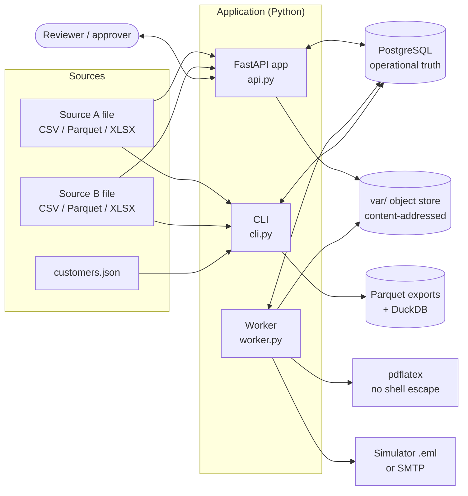
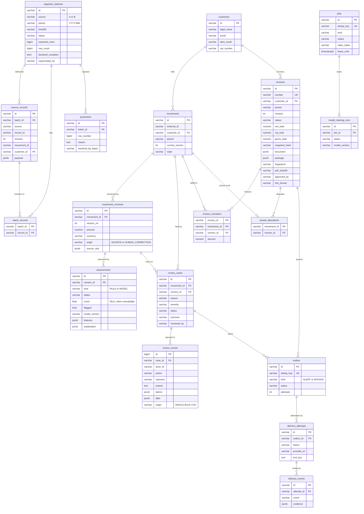
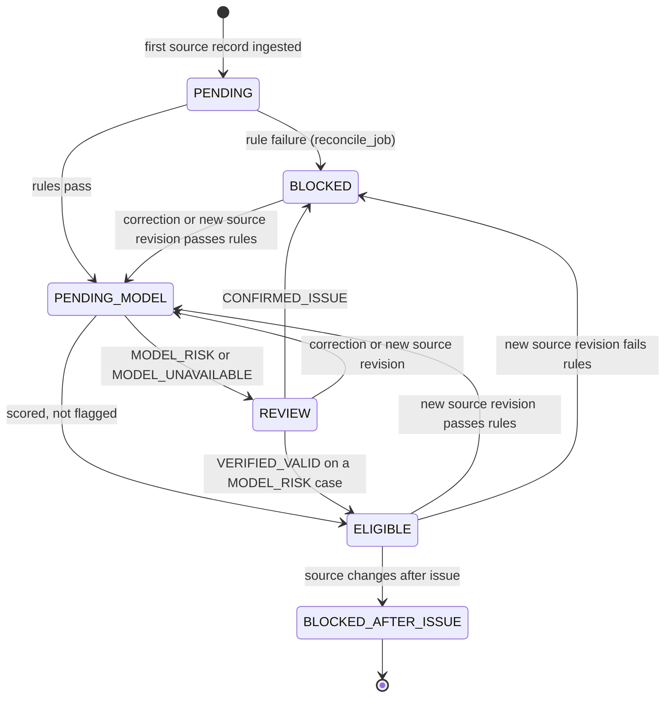
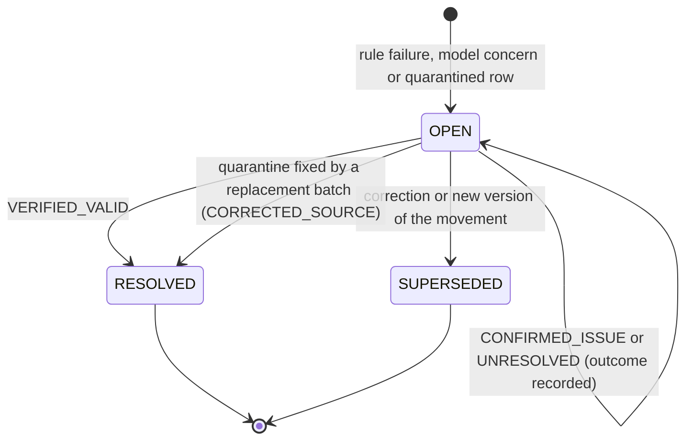
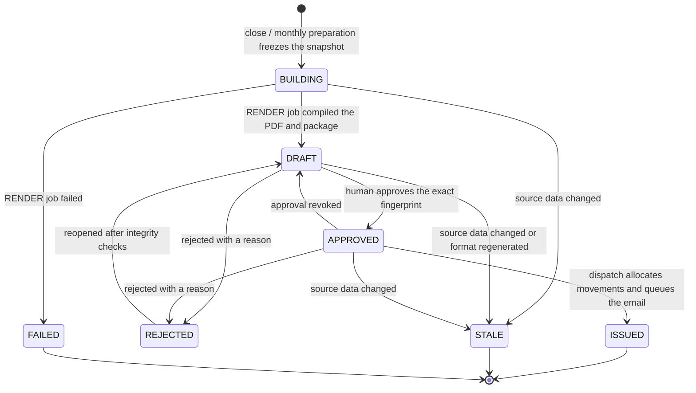
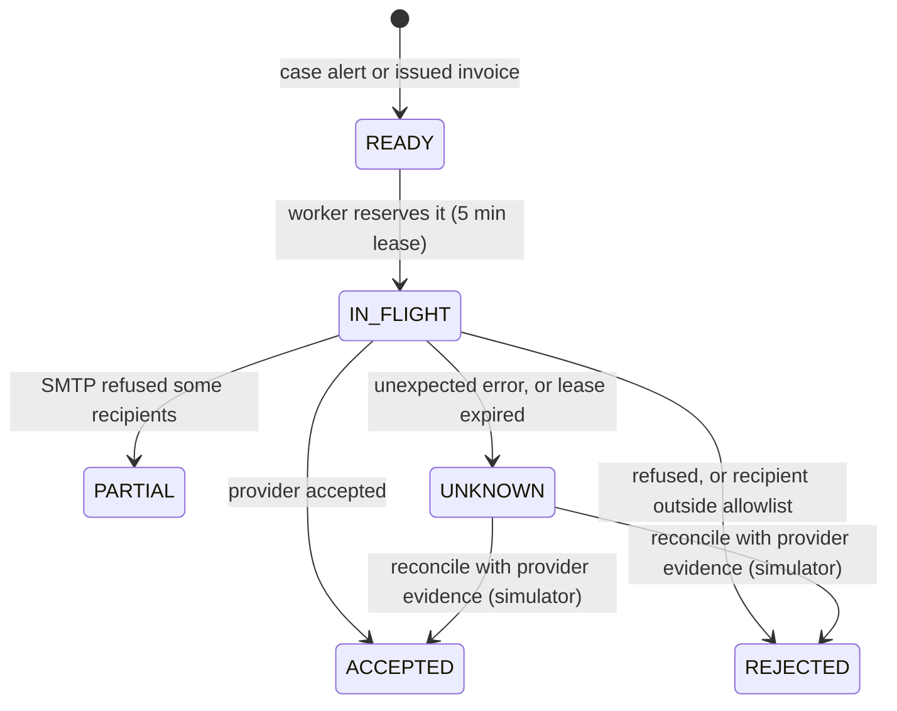
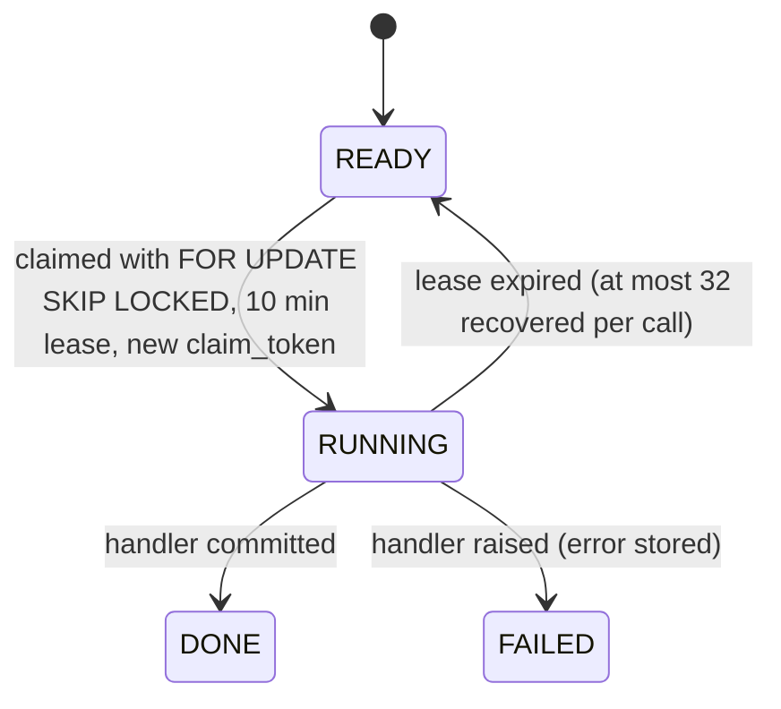
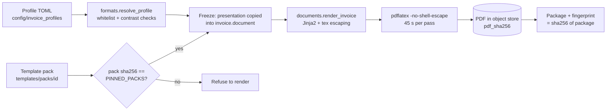

# Architecture

This document explains how Invoice Optimizer is built, module by module. It
describes the code in `src/invoice_optimizer/` as it is, not a target design.
Every table, state and job kind named here exists in the source. Where a
behaviour is a deliberate limit of this release, it says so.

- [1. The shape of the system](#1-the-shape-of-the-system)
- [2. Processes and threads](#2-processes-and-threads)
- [3. Module map](#3-module-map)
- [4. Data model](#4-data-model)
- [5. Lifecycles (state machines)](#5-lifecycles-state-machines)
- [6. The job queue](#6-the-job-queue)
- [7. Concurrency, locking and idempotency](#7-concurrency-locking-and-idempotency)
- [8. Files and the object store](#8-files-and-the-object-store)
- [9. Invoice rendering and render identity](#9-invoice-rendering-and-render-identity)
- [10. Delivery and the outbox](#10-delivery-and-the-outbox)
- [11. API, sessions and live updates](#11-api-sessions-and-live-updates)
- [12. Read scaling and analytics](#12-read-scaling-and-analytics)
- [13. Schema migrations](#13-schema-migrations)
- [14. Front end](#14-front-end)

## 1. The shape of the system

Invoice Optimizer turns two independent source feeds of billable *movements*
into monthly UK-style VAT invoices. A person stays in the loop at two points:
reviewing flagged movements, and approving the exact invoice package before
anything is issued. Everything else (intake, reconciliation, scoring, monthly
preparation, rendering, queueing) is automatic and can be paused.

Three rules shape every module:

1. **PostgreSQL is the single source of truth.** Every decision, counter,
   queue entry and audit record is a row in one database. There is no message
   broker and no cache that can disagree with it.
2. **Evidence is append-only.** Source bytes are kept as received, corrections
   create new movement versions, review and audit tables reject `UPDATE`,
   `DELETE` and `TRUNCATE` through triggers.
3. **Nothing is guessed.** A missing model score is `NULL`, never zero. A
   deterministic rule failure cannot be cleared by a reviewer. An uncertain
   email submission is `UNKNOWN`, never retried blindly.

## 2. Processes and threads

| Process | Started by | What it does |
|---|---|---|
| API | `invoice-optimizer serve` (or `scripts/run_local.py`) | Serves the console (`/`, `/static/*`), the JSON API and the SSE stream. Does **not** create tables. |
| Worker | `invoice-optimizer worker` | Main loop: heartbeat every 5 s, `dispatch_approved`, then `tick` over `ASSESS`, `SCORE` and `RENDER` jobs and outbox sends. Two daemon threads: monthly preparation (every 60 s) and synthetic model training (`TRAIN_MODEL` jobs). |
| Schema initialiser | `invoice-optimizer init-db` | Creates or upgrades the schema under a global advisory lock. Idempotent. |
| CLI commands | `invoice-optimizer <command>` | Ingestion, close, export, insights, benchmark, maintenance, format tools. Each opens its own database pool with `application_name=invoice-optimizer-cli`. |

`scripts/run_local.py` starts exactly one API and one worker on localhost and
writes `var/api.log` and `var/worker.log`. `compose.yaml` runs the same
commands as the `api`, `worker` and one-off `init-db` services.

## 3. Module map

The diagram groups modules by responsibility. Arrows show the main call
direction, simplified.

```mermaid
flowchart TB
    subgraph Entry["Entry points"]
        cli["cli.py"]
        api["api.py"]
        gmail_routes["gmail_routes.py"]
        worker["worker.py"]
        scheduler["scheduler.py"]
    end
    subgraph Domain["Domain"]
        ingestion["ingestion.py"]
        assessment["assessment.py"]
        billing["billing.py"]
        delivery["delivery.py"]
        bulk["bulk_review.py / review_import.py"]
        triage["triage.py"]
        operations["operations.py"]
        operators["operators.py"]
    end
    subgraph Evidence["Evidence and read models"]
        history["review_history.py"]
        versions["review_versions.py"]
        cards["review_cards.py / review_card_drivers.py"]
        explain["risk_explanations.py"]
        provenance["provenance.py"]
        insights["insights.py"]
        analytics["analytics.py"]
    end
    subgraph Model["Model"]
        features["features.py"]
        ml["ml.py"]
        model_ops["model_ops.py"]
        synthetic["synthetic.py"]
    end
    subgraph Documents["Documents"]
        formats["formats.py"]
        documents["documents.py"]
        movement_vat["movement_vat.py"]
        preview["invoice_preview.py"]
    end
    subgraph Infra["Infrastructure"]
        db["db.py"]
        models["models.py"]
        storage["storage.py"]
        config["config.py"]
        secrets["auth_secrets.py"]
        gmail["gmail.py"]
        maintenance["maintenance.py"]
    end
    cli --> ingestion
    cli --> billing
    cli --> analytics
    cli --> insights
    cli --> maintenance
    cli --> formats
    api --> ingestion
    api --> assessment
    api --> billing
    api --> bulk
    api --> insights
    api --> preview
    api --> operators
    gmail_routes --> gmail
    worker --> assessment
    worker --> billing
    worker --> delivery
    worker --> scheduler
    worker --> model_ops
    scheduler --> billing
    assessment --> ml
    assessment --> history
    ml --> features
    model_ops --> ml
    model_ops --> synthetic
    billing --> documents
    billing --> movement_vat
    billing --> provenance
    documents --> formats
    Domain --> db
    db --> models
```

| Module | Responsibility |
|---|---|
| `config.py` | `Settings.from_env()` reads every environment variable; `prepare()` validates them and creates the `var/` subdirectories. Refuses to start outside synthetic mode. |
| `db.py` | Engines and sessions, the advisory `lock()` helper, `replay()`/`record_command()` idempotency, operational counters, `audit()`, and `Database.init()` with migrations 1-8. |
| `models.py` | SQLAlchemy models for the core tables. IDs are 32-hex time-ordered UUIDv7 values (`uid()`). |
| `storage.py` | `ObjectStore`: content-addressed files under `var/objects/<2 hex>/<sha256>`, written read-only (`0440`) and verified on read when asked. |
| `ingestion.py` | Streams CSV, Parquet or XLSX in chunks of `INVOICE_BATCH_SIZE`, validates every row against the source contract, quarantines bad rows, upserts movements and queues `ASSESS` jobs. |
| `assessment.py` | `reconcile_job` (deterministic A/B rules, new versions, cases), `score_job` (model), `correct_case` and `resolve_case` (human decisions). |
| `features.py`, `ml.py` | Six row-local features; frozen scikit-learn Logistic Regression with exact additive log-odds explanations. |
| `model_ops.py` | Queued, auditable synthetic training runs and atomic model activation. |
| `billing.py` | Close gates, frozen snapshot, invoice document, `RENDER` job, approval, rejection, reopening, revocation and dispatch. |
| `movement_vat.py` | Per-movement VAT rounding with an explicit invoice-level reconciliation line. |
| `formats.py`, `documents.py` | Template packs and profiles; Jinja2-escaped LaTeX rendered by real `pdflatex`. |
| `scheduler.py` | Picks due customer-periods for monthly preparation and approved invoices for dispatch, in bounded batches. |
| `delivery.py` | Outbox submission (simulator or SMTP), lease recovery to `UNKNOWN`, simulated provider events, reconciliation. |
| `operations.py` | Persisted automation switches and limits; ingestion admission (queue high-watermark). |
| `operators.py`, `auth_secrets.py` | Personal accounts (PBKDF2-SHA256, 600,000 iterations) and the private session-signing key. |
| `review_*.py`, `triage.py`, `bulk_review.py` | Review history, version carousel, card projections, postponements, bulk release and CSV import. |
| `insights.py`, `analytics.py` | Read-only statistics and verified Parquet exports. |
| `gmail.py`, `gmail_routes.py` | Gmail OAuth connection management. Not connected to the outbox in this release. |
| `maintenance.py` | Retention of finished jobs and old idempotency records; VACUUM/ANALYZE hints. |
| `benchmark.py`, `synthetic.py` | Reproducible synthetic data and an isolated, measured pipeline run. |

## 4. Data model

The core tables are defined in `models.py`. Three more come from
`operators.py` (`operators`), `review_history.py` (`review_events`) and
`model_ops.py` (`model_training_runs`). Only the key columns are shown.

Other tables, not drawn: `audit_events` (append-only, BIGINT id), `commands`
(idempotency: `request_id`, `payload_hash`, `response`), `runtime_options`
(automation settings, scheduler cursors and reports, worker heartbeat),
`operational_counters` (movement-state totals maintained in the same
transaction), `invoice_source_manifests` and `invoice_source_files` (derived
provenance), `operators`, and `schema_migrations`.

Identity rules worth knowing:

- A source record is identified by `(source, record_id, revision)`. Re-sending
  the same record with the same payload is a no-op; a changed payload under the
  same key is quarantined.
- A movement's internal ID is a hash of `(customer_id, movement_id)` from the
  source. A movement cannot move to another period.
- `issued_allocations.movement_id` is a primary key, so a movement can be
  issued on at most one invoice, ever.

## 5. Lifecycles (state machines)

### Movement (`movements.state`)

Notes taken from `assessment.py`:

- Every new version (from a source change or a human correction) runs the rules
  again, so it lands in `BLOCKED` or `PENDING_MODEL` and is scored again.
- `VERIFIED_VALID` is accepted only for a `MODEL_RISK` case with passing rules,
  a complete model score, no other open case on that version and no issued
  allocation. Rule failures and `MODEL_UNAVAILABLE` cannot be released by review;
  they need a correction or new source data.
- Monthly close requires **every** movement of the customer-period to be
  `ELIGIBLE`.

### Review case (`review_cases.status`)

### Invoice (`invoices.status`)

`STALE` and `FAILED` invoices are kept as evidence; a new revision can then be
prepared for the same customer and period. `ISSUED` is final in this release:
changing an issued movement requires an adjustment workflow (credit note) that
is not implemented, so the system blocks it.

### Outbox row and delivery attempt

Simulated `delivered`, `bounced` and `opened` events can be attached to an
`ACCEPTED` attempt. They are stored as separate `delivery_events` rows and are
never treated as proof that a person read the message.

## 6. The job queue

Internal work is a row in `jobs`. Kinds: `ASSESS`, `SCORE`, `RENDER`,
`TRAIN_MODEL`.

- Each job has a unique `dedup_key`, so a retried enqueue cannot duplicate work.
- A handler re-checks `claim_token` before committing, so a worker whose lease
  expired cannot overwrite the result of the worker that took over.
- Claims rotate across job kinds per process, using the partial index
  `ix_jobs_kind_ready`, so a large backlog of one kind does not starve another.
- `ASSESS` jobs hold at most `INVOICE_WORKER_BATCH_SIZE` movements.
- Email sending is not a job: it reads `outbox` rows directly, also with
  `SKIP LOCKED`.

## 7. Concurrency, locking and idempotency

Financial consistency relies on PostgreSQL transaction-scoped advisory locks
(`db.lock()`, `pg_advisory_xact_lock` on a hash of the key):

| Lock key | Taken by | Serialises |
|---|---|---|
| `period:<YYYY-MM>` | Ingestion start/finish, invoice freeze, approval, dispatch, batch supersession | Close against new deliveries for the same period |
| `customer-period:<customer>:<period>` | Ingestion chunks, reconcile, score, correction, review, freeze, approval, dispatch | Every change to one customer's month |
| `source:<A or B>` | Each ingestion chunk | Concurrent deliveries of the same source |
| `command:<request_id>` | `replay()` | Two submissions with the same request ID |

Every state-changing API command carries a `request_id`. `replay()` stores the
canonical payload hash and the response in `commands`. An identical retry gets
the recorded response; the same ID with a different payload is a `409`.
`maintenance --prune-commands-older-than` can delete old records; after that a
very late retry runs as a new command.

Optimistic concurrency sits on top: reviews and corrections carry the
`expected_version` the reviewer saw, and approvals carry the package
`fingerprint`. Any mismatch is a `409 Conflict`.

## 8. Files and the object store

`INVOICE_DATA_DIR` (default `var/`) holds:

| Directory | Contents |
|---|---|
| `objects/` | Content-addressed blobs: original source files, invoice snapshots, PDFs, `.eml` messages, logos. Key = SHA-256 of the bytes. |
| `documents/` | Rendering work directories (TeX, logs, `render.json`). |
| `model/` | Frozen model artifacts and the active-model pointer. |
| `mail/` | Simulator `.eml` copies and provider journals. |
| `exports/` | Parquet analytical exports. |
| `reports/`, `incoming/`, `synthetic/` | Receipts, uploaded files in transit, generated datasets. |
| `private/` | `session-signing.key` (64 bytes, mode `0600`). |

The API and the worker must see the **same** data directory. Compose mounts
one volume (`invoice-data`) into both. Running them on different hosts needs a
shared filesystem; shared object storage (for example S3) is not implemented.

## 9. Invoice rendering and render identity

- Appearance comes from two parts: a **template pack** (trusted LaTeX, reviewed
  code, pinned by SHA-256 in `formats.PINNED_PACKS`) and a **profile** (company
  data only, validated field by field).
- At freeze time the resolved profile, pack hash and logo hashes are copied
  into the invoice document. Later edits to profile files never change an
  existing invoice.
- A document without a `presentation` block renders with the frozen legacy
  pack `uk-classic-v3`, whose template `templates/uk_invoice.tex.j2` is pinned
  byte for byte. Its render identity keeps the original formula, so every PDF
  produced before format profiles existed still verifies.
- See [INVOICE_FORMATS.md](INVOICE_FORMATS.md) for the field reference and
  the step-by-step procedure.

## 10. Delivery and the outbox

Issuing an invoice (`dispatch_invoice`) is one transaction: it re-validates the
snapshot and the PDF checksum, inserts one `issued_allocations` row per member
movement, sets the invoice `ISSUED`, and inserts an `INVOICE` outbox row whose
payload is the approved package. The email is sent later by the worker.

- `INVOICE_PROVIDER=simulated` (default) writes the message as `.eml` plus a
  provider journal under `var/mail/`. Nothing leaves the machine.
- `INVOICE_PROVIDER=smtp` uses STARTTLS on `SMTP_HOST:SMTP_PORT`, logs in when
  `SMTP_USER` is set, and refuses any recipient whose domain is not in
  `INVOICE_ALLOWED_EMAIL_DOMAINS`.
- Any unexpected exception during submission, or a lease that expires while a
  row is `IN_FLIGHT`, marks the attempt `UNKNOWN`. Unknown attempts are never
  retried automatically; in simulator mode they can be reconciled against the
  provider journal (`POST /api/attempts/{id}/reconcile`).
- Gmail: `gmail.py` stores an OAuth connection (scopes `gmail.send`, `openid`,
  `email`). No code path sends invoice email through Gmail yet.

## 11. API, sessions and live updates

- FastAPI, no OpenAPI or docs endpoints exposed (`docs_url=None`).
- Personal sign-in sets an `invoice_session` cookie (signed with the private
  key, `HttpOnly`, `SameSite=Strict`, `Secure` when the public URL is HTTPS or
  `INVOICE_SECURE_COOKIES=1`, 8 h lifetime). Unsafe methods need the
  `X-CSRF-Token` header and a same-origin `Origin`.
- The shared `INVOICE_API_TOKEN` (bearer or legacy login) is **read-only**.
  Only personal operator accounts can change anything; administrators manage
  accounts and automation settings.
- Login attempts are rate-limited per IP (60/min) and per credential (10/min).
- Every response carries a CSP (`default-src 'self'`, `object-src 'none'`,
  `frame-ancestors 'self'`), `X-Content-Type-Options`, `X-Frame-Options`,
  `Referrer-Policy`, `Permissions-Policy` and COOP. HSTS is added when the
  public URL is HTTPS.
- `GET /api/events` is a Server-Sent Events stream. One cached dashboard
  summary per API process is refreshed every two seconds; each event carries a
  `stream_version` and `changed_resources` hints so the browser reloads only
  affected views. The stream ends with `auth_expired` when the session expires
  or the account is deactivated.
- Lists use bounded pages (`limit` up to 100) with offset or keyset cursors.

## 12. Read scaling and analytics

- `DATABASE_READ_URL` routes list, report, CSV export and insight reads to a
  second engine (for example a streaming replica). Close, approval and dispatch
  validation always read the primary.
- `db.read_transaction()` sets `READ ONLY` even on the primary, so routing a
  read to a replica cannot change behaviour.
- Insights run in one `REPEATABLE READ READ ONLY` snapshot per request, are
  cached per process for 30 s and limited to two concurrent computations.
- `invoice-optimizer export --period YYYY-MM` writes ZSTD Parquet with exact
  decimal columns and verifies counts and sums against the same SQL snapshot
  with DuckDB. `insights.insights_from_parquet` analyses those files offline.

See [INSIGHTS.md](INSIGHTS.md), [ANALYTICS.md](ANALYTICS.md) and
[PERFORMANCE.md](PERFORMANCE.md).

## 13. Schema migrations

There is no external migration tool. `Database.init()` runs under
`pg_advisory_xact_lock(918204660)` in one transaction:

1. `create_all` for every model (new tables only).
2. Numbered, idempotent steps recorded in `schema_migrations` (versions 1-8):
   invoice number sequence, quarantine customer column, job claim tokens,
   partial claim indexes, append-only triggers on `audit_events` and
   `review_events`, model explanation column, lease index, and migration 8
   (index rework, BRIN indexes, denormalised invoice list columns).

Run `invoice-optimizer init-db` after every upgrade, with the API and worker
stopped. On a large live database, create migration 8's indexes
`CONCURRENTLY` with the same names first (the names are in `db.py`); `init-db`
then skips them.

## 14. Front end

A single HTML page (`templates/index.html`) with vanilla JavaScript and CSS, no
framework, no build step and no remote assets. Modules: `app.js` (views and
API calls), `theme.js` (display preferences, loaded first), `tokens.css` (OKLCH
design tokens), `app.css`, `charts.js` (inline SVG charts), `shortcuts.js`
(command palette and keyboard map), `motion.js`, plus the card deck, swipe and
risk-bar modules. See [UI_DESIGN.md](UI_DESIGN.md).
