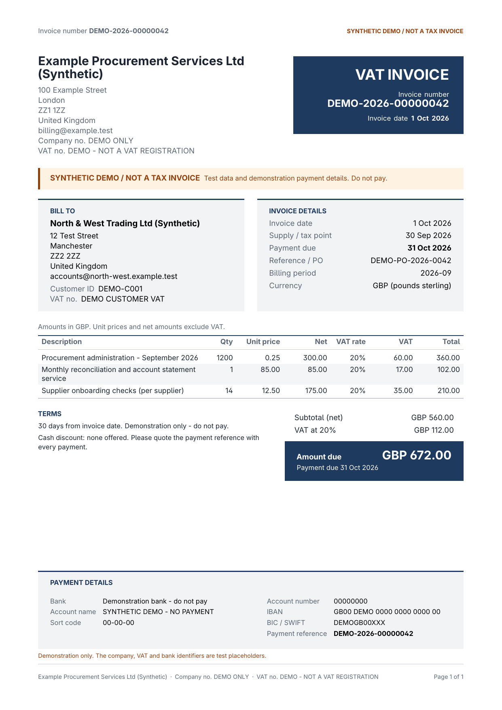
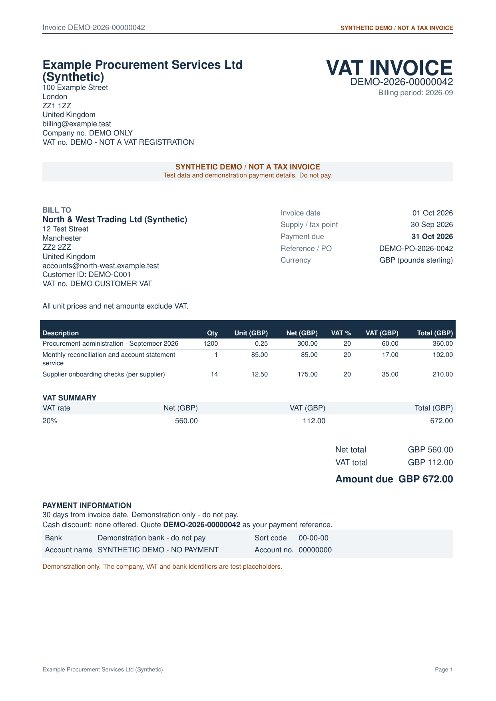

# Invoice formats: template packs and format profiles

An invoice PDF's appearance comes from two pieces:

- **Template pack**: trusted LaTeX in `src/invoice_optimizer/templates/packs/<pack_id>/`, consisting of `pack.toml` and `invoice.tex.j2`. Each pack is pinned by sha256 in `src/invoice_optimizer/formats.py` (`PINNED_PACKS`). If an installed pack no longer matches its pin, the application refuses to render with it. Changing a pack therefore always goes through code review.
- **Format profile**: company data in `config/invoice_profiles/<profile_id>.toml`: colours, font, paper, labels, logo, seller identity and bank details. A profile can never contain TeX. Every value is checked against a whitelist, and text is escaped before it reaches the template.

| Pack | Renderer version | Notes |
|---|---|---|
| `uk-modern-v1` (default) | `uk-modern-v1` | Accent header block, Bill to / Invoice details cards, zebra line table, one filled *Amount due* panel, payment card with optional IBAN/BIC, optional logo, PDF metadata, Inter font. A4 or US Letter. Column widths follow the paper and margins. |
| `uk-classic-v3` (legacy) | `uk-a4-v3-movement-vat` | The original `templates/uk_invoice.tex.j2`, kept byte-identical. Only a profile's `[seller]` block applies. Documents frozen before profiles existed (with no `presentation` key) always render with this pack, using the original render identity. |

Previews of page 1 (synthetic data):




## Changing the invoice format, step by step

1. **Edit or copy a profile.** Copy `config/invoice_profiles/default.toml` to a new file, for example `acme.toml`. Profile ids are 1-64 characters drawn from lowercase letters, digits, `-` and `_`. Change only the fields listed in the reference below. To add a logo, put a PNG, JPG or PDF of at most 512 KB in `config/invoice_profiles/assets/` and set `logo = "acme-logo.png"`.
2. **Validate it:**
   ```sh
   invoice-optimizer format validate acme
   ```
   On success the command prints the resolved profile with its `profile_sha256` and asset hashes. On failure it prints the reason and exits with status 1. `invoice-optimizer format list` shows every installed pack and profile with its status.
3. **Preview it:**
   ```sh
   invoice-optimizer format preview --profile acme --out /tmp/acme-preview [--itemized]
   ```
   This renders a synthetic sample invoice (marked SYNTHETIC on every page) to `acme-preview.pdf`. If Poppler's `pdftoppm` is installed, page 1 is also written as `acme-preview.png`. Nothing is written to the database. Look at the PNG or PDF before going further.
4. **Activate it.** Set `INVOICE_FORMAT_PROFILE=acme` in the environment of every process that freezes invoices: the API, the worker and the CLI. If profiles live outside the working directory, also set `INVOICE_PROFILE_DIR` (default `config/invoice_profiles`, resolved against the working directory). Logos are always read from `<INVOICE_PROFILE_DIR>/assets/`.
5. **Restart** the API and the worker. Settings are read once at start-up, and an invalid `INVOICE_FORMAT_PROFILE` id stops start-up.
6. **What changes, and when.** Only drafts frozen *after* the restart use the new profile. At freeze time the resolved profile, the pack hash and the logo hash are copied into the invoice document, and the logo bytes are stored in the content-addressed object store. Existing drafts, approved and issued invoices, and retained PDFs never change. Editing or deleting the profile file later also has no effect on them.
7. **Restyling an existing draft (optional).** A current, unapproved DRAFT can be regenerated with the active profile through the normal regeneration endpoint, `POST /api/invoices/{id}/format`, using its current fingerprint and its current `line_format`. Regeneration follows the same rules as a line-format change: the old draft becomes STALE and keeps its PDF, the new draft keeps the exact snapshot and totals, both sides of the change are audited (`from_presentation` / `to_presentation`), and the new draft needs its own human approval. If neither the line format nor the presentation would change, the request is refused.

If the active profile becomes invalid, for example because the logo was deleted, new freezes fail with `Invoice format profile is not usable: ...` instead of producing an unstyled invoice.

## Field reference (`uk-modern-v1`)

| Field | Allowed values | Default | Notes |
|---|---|---|---|
| `description` | text, max 200 characters | `""` | Shown by `format list`. |
| `pack` | `uk-modern-v1`, `uk-classic-v3` | `uk-modern-v1` | Must be a pinned pack. |
| `paper` | `a4`, `letter` (only papers the pack declares) | `a4` | |
| `margins_mm` | whole number, 12-25 | `16` | Top and bottom margins add room for the header and footer. |
| `font` | `inter`, `helvet`, `sourcesanspro`, `FiraSans`, `roboto`, `tgheros`, `lato` | `inter` | Each name maps to a pdfLaTeX line in `formats.FONTS` that has been verified to compile. |
| `date_format` | `d MMM yyyy`, `dd MMM yyyy`, `d MMMM yyyy`, `dd/MM/yyyy`, `yyyy-MM-dd` | `d MMM yyyy` | Uses a fixed English month table and ignores the process locale. |
| `vat_summary` | `always`, `multi_rate_only` | `multi_rate_only` | With a single rate, the totals panel already shows "VAT at 20%". |
| `footer_text` | text, max 300 characters, single line | `""` | If empty, the footer shows seller name, company number and VAT number. |
| `logo` | relative path under `assets/`, `.png`/`.jpg`/`.pdf`, max 512 KB | `""` | Rejected if absolute, contains `..`, uses a backslash, or resolves outside the assets directory (including through symlinks). File contents must match the extension. |
| `[colors] accent, ink, muted` | 6-digit hex, `#` optional | `1F3A5F`, `1B2430`, `5B6675` | Each colour needs at least 4.5:1 contrast against white (WCAG AA), because white text sits on `accent` and `ink`/`muted` text sits on white. |
| `[labels]` | known keys only, 1-80 characters, no line breaks | built-in English | Keys: `bill_to`, `invoice_details`, `invoice_number`, `invoice_date`, `tax_point`, `due_date`, `reference`, `period`, `customer_id`, `currency`, `description`, `quantity`, `unit_price`, `net`, `vat_rate`, `vat`, `total`, `vat_summary`, `subtotal`, `vat_total`, `amount_due`, `payment`, `terms`, `bank`, `account_name`, `sort_code`, `account_number`, `iban`, `bic`, `payment_reference`. The document title (`VAT INVOICE` / `INVOICE`) and the synthetic banner are fixed. |
| `[columns]` | `quantity`, `unit_price`, `vat_rate`, `line_vat`, `line_total` (booleans) | all `true` | `quantity`, `unit_price` and `vat_rate` cannot be turned off (Notice 700 s16.3). In non-VAT mode the VAT columns are hidden automatically. |
| `[payment]` | `show_iban_bic` (bool), `extra_note` (text, max 300 characters) | `true`, `""` | |
| `[seller]` | `legal_name`, `address` (multi-line), `email`, `company_number`, `vat_number`, `bank_name`, `account_name`, `sort_code`, `account_number`; optional `iban`, `bic` | demo seller | Replaces the former hard-coded `billing.SELLER`. The billing adapter issues VAT invoices, so `vat_number` must not be empty. |

Unknown keys anywhere in the profile are rejected. `uk-classic-v3` accepts only `pack`, `description` and `[seller]`.

## Integrity and render identity

- A document without `presentation` uses the legacy identity `sha256("uk-a4-v3-movement-vat:" + document_sha256 + ":" + template_sha256)` with the pinned legacy template. Existing tests and retained PDFs keep verifying.
- A document with `presentation` uses `sha256("v2:" + renderer_version + ":" + document_sha256 + ":" + pack_sha256 + ":" + sha256(assets))`. The renderer re-validates the embedded profile and checks that `profile_sha256`, the asset map and the seller block all agree. It refuses to render if the installed pack hash differs from `presentation.pack_sha256`. It copies assets from the object store with checksum verification.
- `render.json` adds `pack_id`, `pack_sha256`, `profile_id`, `profile_sha256`, `asset_sha256s`, `identity_formula` and the pdfTeX banner. Older receipts that lack these keys are still verified.
- The invoice package (and therefore its approval fingerprint) includes `presentation` = pack, renderer version, pack hash, profile id, profile hash and asset hashes.

## Creating a new template pack (code review required)

1. Copy `templates/packs/uk-modern-v1/` to a new id, for example `uk-modern-v2`. Never edit a released pack in place: frozen drafts name its hash.
2. Set `id`, `title`, `renderer_version` (new and unique), `papers` and `profile_fields` in `pack.toml`.
3. Edit `invoice.tex.j2`. Every value that comes from a document or profile must pass through the `tex` / `texdetail` filters, or be one of the already validated enums, hex colours or integers. Do not add `\input`, `\write`, shell escape or file paths taken from data.
4. Add the pack to `PINNED_PACKS` in `formats.py` with its `pack_sha256` (`formats.pack_digest('<id>')`). If any Python-side formatting changes, version it with the new pack.
5. Add tests that compile the pack with real pdfLaTeX: VAT, non-VAT, multi-page, and itemised with and without movement VAT. Also check that the banner and invoice number appear on every page, that *Amount due* appears exactly once, and that the log has no Overfull boxes. Then run `format preview` and look at the result.
6. Ship it, then point a profile at the new pack.

## Legal content checklist (HMRC VAT Notice 700 s16.3, GOV.UK invoicing guidance)

Every pack must show all of the following. The renderer validates the arithmetic whatever the layout.

- [ ] Unique sequential invoice number
- [ ] Invoice (issue) date and supply / tax point date
- [ ] Seller legal name, address, company number and, in VAT mode, VAT registration number
- [ ] Customer name and address
- [ ] For each line: description, quantity or extent, unit price, VAT rate, and net amount
- [ ] Total excluding VAT, total VAT, and amount payable, all in GBP; per-rate breakdown when more than one rate applies
- [ ] Cash-discount statement (none offered in v1)
- [ ] Payment terms, due date and payment instructions with the reference
- [ ] Non-VAT mode: no VAT title or VAT number, with an explicit "not VAT registered" statement
- [ ] Synthetic documents: `SYNTHETIC DEMO / NOT A TAX INVOICE` on every page
- [ ] Itemised detail: every movement listed once, plus the movement-VAT reconciliation and any rounding adjustment shown explicitly

See [UK_INVOICE_FORMAT.md](UK_INVOICE_FORMAT.md) for the arithmetic and VAT policy contract.
